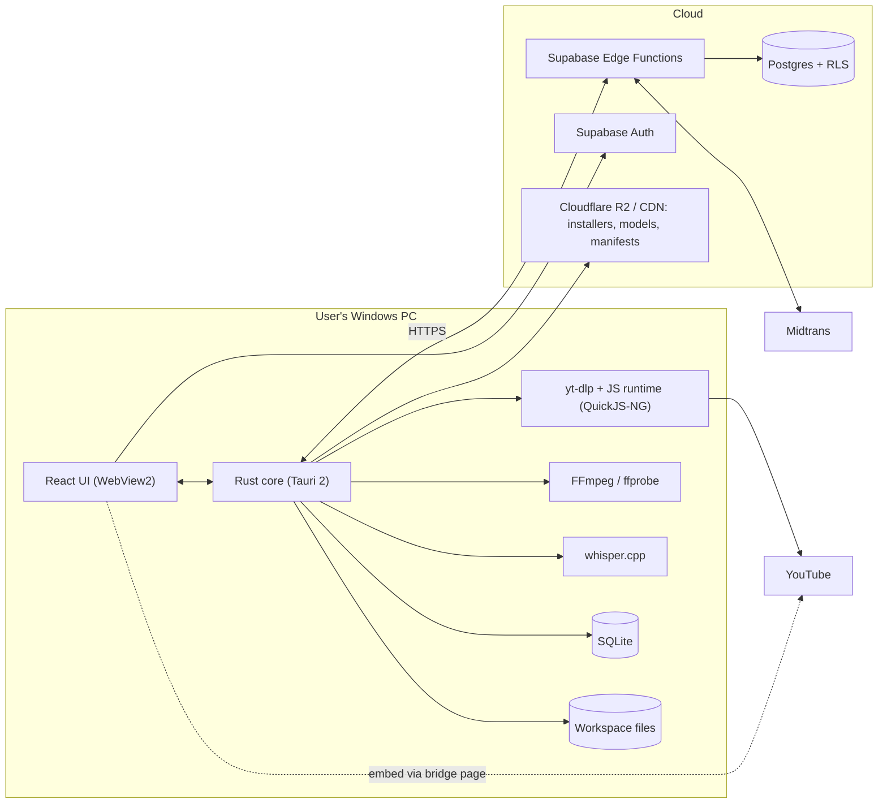
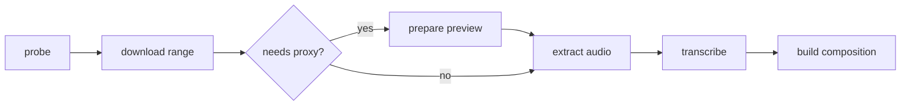
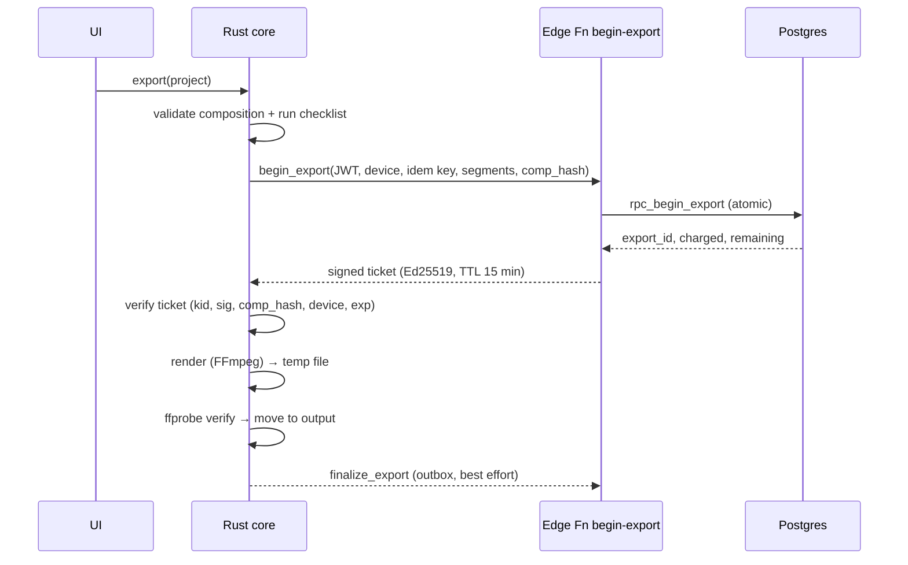

# Architecture

## 1. System context



## 2. Principles

1. **Local-first compute.** Download, transcribe, preview and render run on the user's machine. The cloud holds only identity, money, credits, templates and config.
2. **Server authoritative, client verifying.** The server decides what a user may export; the app verifies a signed ticket before rendering.
3. **Idempotent and resumable.** Every job stage is cacheable by content key and survives crashes.
4. **Schema-validated boundaries.** Composition, templates, tickets, manifests, IPC and HTTP bodies all have versioned schemas.
5. **Config over code.** Plans, limits, tolerances, feature flags, minimum version live in the DB.
6. **Observable by default.** Structured logs, stage timings, error codes, ETA accuracy.
7. **Replaceable edges.** Source providers, encoders, speech model, payment gateway sit behind interfaces.

## 3. Technology choices

| Concern | Choice | Why / alternative |
|---------|--------|-------------------|
| Desktop shell | **Tauri 2** (Rust + WebView2) | Small installer, memory-light, security model (capabilities), sidecar support. Alternative: Electron (all-TS, heavier). |
| UI | React + TypeScript (strict) + Tailwind | Team's existing stack. |
| State | Zustand + immer (editor), TanStack Query (server) | Simple; command-pattern undo/redo on top of the composition. |
| Typed IPC | Rust-generated TS bindings (e.g. tauri-specta) | One source of truth for commands/events. |
| Local DB | SQLite (rusqlite or sqlx) | Projects, jobs, artifacts index, ETA stats, outbox. |
| Secure storage | Windows Credential Manager (`keyring` crate) | Refresh tokens, device secret. |
| Downloader | **yt-dlp** sidecar + **QuickJS-NG** JS runtime | Approach A (`--download-sections`, copy mode) chosen in S1. `--force-keyframes-at-cuts` is **forbidden** (with an LGPL FFmpeg it silently falls back to the mpeg4 encoder). Official `yt-dlp.exe` release (bundles EJS); pin version `2026.10.26` + SHA-256 (`f5389d…7a7d`). QuickJS-NG (`qjs.exe` v0.18.0, MIT, 1.87 MB) via `--js-runtimes "quickjs:<bin_dir>\qjs.exe"`. Deno is **not** bundled but may ship later as a fallback JS runtime via the signed component manifest. Node is supported. Bun is deprecated by yt-dlp — do not use. |
| Media | **FFmpeg + ffprobe** sidecars (LGPL build) | Cut, reframe, burn-in ASS captions, encode, probe. |
| Speech-to-text | **whisper.cpp** sidecar (CPU build; optional Vulkan build) | Local, MIT, good Indonesian support; model chosen by hardware probe. |
| Captions | ASS subtitles burned by FFmpeg (libass); preview with the same renderer (e.g. libass-WASM/JASSUB) | Preview == export. |
| Backend | **Supabase** (Postgres, Auth, Edge Functions, Storage) in **Singapore** | Closest region to Indonesia; one platform; RLS. |
| Payments | **Midtrans Snap** (hosted checkout) | Already registered; QRIS/e-wallet/VA/cards without handling card data. |
| Static hosting | Cloudflare R2 + CDN (installers, models, manifests) | No egress fees for multi-GB distribution. |
| Web (small) | Astro static site on Vercel/Cloudflare Pages | Landing, legal pages, payment-finish page. |
| Crash/error reporting | Sentry (opt-in in app; always on for Edge Functions) | Visibility without building tooling. |
| CI/CD | GitHub Actions (Windows runner) | Build, test, sign, publish, generate update manifests. |

## 4. Desktop app structure

```
apps/desktop/
├─ src/                    # React UI
│  ├─ features/{home,source,generate,editor,templates,export,account,settings}
│  ├─ components/ ├─ state/ ├─ ipc/ (generated) └─ i18n/
└─ src-tauri/src/
   ├─ commands/            # thin Tauri commands (validate → call services)
   ├─ jobs/                # job runner, stage pipeline, cancellation, resume
   ├─ sidecars/            # yt_dlp, ffmpeg, whisper, deno wrappers + Job Object supervisor
   ├─ render/              # composition → FFmpeg args + ASS generation + verification
   ├─ eta/                 # progress aggregation + ETA estimator
   ├─ license/             # ticket verification (Ed25519), account snapshot, device identity
   ├─ net/                 # API client (Edge Functions), retry, backoff, outbox
   ├─ store/               # SQLite, migrations, artifact index, cache policy
   ├─ hardware/            # probe + benchmark + device profile
   ├─ updater/             # app updater + component manifest installer
   └─ security/            # path sanitizing, URL allowlist, integrity checks
```

**IPC contract:** UI → Rust via typed `invoke` commands; Rust → UI via events (`job://<id>` carrying `JobEvent`, see PROGRESS_AND_ETA §3). The UI never spawns processes or touches arbitrary paths.

**Tauri capabilities (least privilege):** no broad shell/fs permissions; sidecars only through Rust; asset protocol scoped to the workspace directory; production builds with devtools disabled and a strict CSP (no remote scripts; `frame-src` limited to the bridge origin).

## 5. Pipelines

### 5.1 Generate (free)



| Stage | Tool | Work unit | Cache key |
|-------|------|-----------|-----------|
| probe | yt-dlp `-J` | – (indeterminate, ≤30 s timeout) | – |
| download | yt-dlp `--download-sections` (copy mode); reuses probe JSON via `--load-info-json` (saves ~6 s extraction). Probe JSON is a **temp file** (contains signed URLs, ~6 h TTL) — delete after the stage, never log or sync. On 403 from URL expiry: silent re-probe once and retry; only then surface `E_YT_RATE_LIMITED`. | media-seconds (from FFmpeg `time=`/`speed=` output, ~1.4–1.9 ev/s; 6–11 s startup is indeterminate — show "Menyiapkan unduhan…") | sha256(provider, video_id, start, end, format selector) |
| prepare preview | FFmpeg (only when source codec is not H.264/AAC — e.g. VP9/AV1-only sources); proxy transcode via `h264_mf` at `-b:v 3500k` with a short GOP (`-g 30`, TO-VERIFY: confirm smooth, frame-accurate seeking in WebView2 during M1). Final export always uses the original file. | media-seconds | sha256(source artifact, preset) |
| extract audio | FFmpeg → 16 kHz mono WAV | media-seconds | sha256(source artifact) |
| transcribe | whisper.cpp (`--print-progress`) | audio-seconds | sha256(audio, model, language, vad) |
| build | Rust | – (<2 s) | – |

Rules:
- **One generate at a time.** Heavy stages run with hardware-appropriate concurrency (default 1).
- Download format preference: H.264 ≤1080p + AAC (plays natively in WebView2, no proxy). Fall back to other codecs + proxy.
- Copy-mode output may contain pre-roll packets before the requested start (negative PTS, discard flag `KD_`). Working definition: `absoluteStartMs = requestedStartMs`; file t=0 = requested start (pre-roll packets are discarded). S1c verified RELATIVE consistency between two downloads ($T$ vs $T-7\text{ s}$) by audio cross-correlation at 3 offsets (0.00 ms error). NOT verified: absolute alignment to YouTube's own player timeline (irrelevant beyond the 15 s entitlement tolerance) and WebView2 `<video>` seeking behavior (inferred, not measured). The M1 sync test (known marker + captions, preview and export align within ±1 frame) remains a hard acceptance gate. Keep a configurable **±5 s** of "editing handles" around the chosen range for trim fine-tuning.
- Baseline copy-mode download measured at **≈1.66× real-time** (5 min range ≈ 3 min, ~94 MB at 1080p60 on Reference R1). YouTube paces un-chunked DASH requests by **TIME** (720p took the same wall time as 1080p), while yt-dlp's native chunked downloader reaches **≈8× real-time** on the same link. Parallel split ($N=2/3/4$) was rejected (not $\ge 2\times$ faster, and copy-mode joins broke at $N=4$). Sequential copy-mode is retained as baseline and placed behind a `RangeDownloader` trait in the Rust core design. Open item S1d (optional, after M1 baseline works): a local range-chunking proxy so FFmpeg reads through chunked upstream requests.
- Failures are stage-scoped; retry resumes from the last good artifact.

### 5.2 Export (credit-gated)



Details in SECURITY §5 and DATA_MODEL §5. The credit is consumed (or the entitlement matched) **at ticket issue**; failures afterwards are retried free.

## 6. YouTube source handling

- **URL intake:** parse in Rust; allow only `youtube.com`, `www.youtube.com`, `m.youtube.com`, `youtu.be`; extract an 11-char video id; build the canonical `https://www.youtube.com/watch?v=<id>` URL. Never pass user text to a shell.
- **yt-dlp flags:** `--no-playlist --no-warnings --newline --ignore-config`, `--js-runtimes "quickjs:<bin_dir>\qjs.exe"`, `--ffmpeg-location <bin_dir>`, `--load-info-json <probe_json>` (reuses the `-J` output), format selector `bv*[vcodec^=avc1][height<=1080]+ba[acodec^=mp4a]/b[vcodec^=avc1][height<=1080]/bv*[height<=1080]+ba/b[height<=1080]`, `--download-sections "*<start>-<end>"`. **Never** pass `--force-keyframes-at-cuts` (see §3).
- **Probe/download split:** probe with yt-dlp `-J`, save output to a temporary workspace file, and reuse it for download via `--load-info-json` (saves ~6 s extraction and challenge execution). The JSON contains signed URLs that expire (~6 h TTL): keep it strictly as a temp file in the workspace, delete it after the stage, and never log or sync it. On a 403 HTTP error during download caused by expired URLs, silently re-probe once and retry; only surface `E_YT_RATE_LIMITED` if the retry also fails.
- **Progress observability (S1 decision — Approach A):** yt-dlp's internal FFmpeg emits `time=`/`speed=` lines at ~1.4–1.9 events/s in copy mode. The 6–11 s startup (extraction + JS challenge resolution) is indeterminate. Reference implementation: `spikes/s1-downloader/progress_parser.py` (port to Rust with the same unit-test cases).
- **Preview proxy for non-AVC1 sources:** when the downloaded stream is not H.264/AAC (e.g. VP9/AV1-only streams), generate a preview proxy with FFmpeg using `h264_mf` at `-b:v 3500k -g 30 -pix_fmt yuv420p` (`-g 30` added as TO-VERIFY: confirm smooth, frame-accurate seeking in WebView2 during M1). The editor and UI preview play this proxy; final export always renders from the original source file. Note: `h264_mf` routes to the GPU vendor's hardware MFT and falls back to a slower software MFT when no hardware encoder exists; to be re-tested on other GPUs during beta. In the Generate stage table (§5.1), `prepare_preview` applies only to this case.
- **Preview strategy (priority order):**
  1. **Official embed through a bridge page** on our own HTTPS origin (`player.<domain>`), loaded in an iframe inside the app. It wraps the IFrame API and relays `currentTime/duration/state` via `postMessage`. Rationale: YouTube embeds fail with "Error 153" when the embedding page sends no acceptable Referer/origin; custom app schemes are a known trigger. The bridge supplies a real HTTPS origin and `referrerpolicy="strict-origin-when-cross-origin"`; consider `youtube-nocookie.com`.
  2. **Storyboard thumbnails** (sprite sheets listed by yt-dlp metadata) + timecode inputs — no video playback.
  3. **Short low-res range preview** downloaded on demand (explicit user action).
- **Unsupported (MVP):** ongoing live streams, private/members-only/age-restricted content, cookies import.

## 7. Composition and render

- **Composition JSON** (DATA_MODEL §7) is canonical: sources, timeline segments (source-relative ms + absolute offset), layout, captions (word timings), overlays, audio, template reference. Coordinates are **normalized 0–1** so they are resolution-independent. Time mapping working definition: `absoluteStartMs = requestedStartMs`; file t=0 = requested start (pre-roll packets carry discard flag). S1c verified relative consistency across offsets via audio cross-correlation (0.00 ms error); absolute timeline alignment beyond 15 s tolerance and WebView2 playback behavior remain to be validated in M1 sync test. Timeline segments map back to absolute VOD time via `absoluteStartMs` for entitlement matching.
- **Canonicalization + hash:** keys sorted, numbers normalized → `comp_hash` (SHA-256). Included in the export ticket.
- **Render builder (Rust):** composition → FFmpeg filtergraph + ASS file.
  - `fill`: crop rect → scale to 1080×1920.
  - `blur_fit`: blurred scaled background + centered contained foreground.
  - `split`: two crops stacked by ratio.
  - Captions: generate ASS (word-highlight via karaoke tags), burn with `ass`/`subtitles` filter, fonts from the bundled set only.
  - Overlays: logo via `overlay`, text via ASS or `drawtext` with bundled fonts.
  - Audio: gain + optional loudness normalization (analysis pass is audio-only and fast).
  - Output: H.264 High, yuv420p, 30 fps default (template may set 60), AAC 48 kHz 128–192 kbps, `+faststart`.
  - **Export presets:** `standard` (quality-targeted, e.g. CRF-based) or `small_file` (bitrate-capped to meet `template.format.maxFileSizeMB` with margin). If the estimated file size at `standard` exceeds the template's size limit, the app selects `small_file` automatically. Users cannot set CRF/bitrate directly in MVP; fps and resolution come from the template. Per-encoder rate-control values live in the Rust render module (mapping table: *fill after S4*).
- **Preview parity:** UI preview applies the same crop/scale math from the shared module and renders ASS with the same libass-based renderer. **Golden tests** compare composition → FFmpeg-args snapshots and ffprobe metadata of a short fixture render.
- **Encoder selection:** probe `h264_nvenc` → `h264_qsv` → `h264_amf` → `h264_mf` (Windows Media Foundation; Windows N/KN editions need the Media Feature Pack) → `libopenh264` only if S5 confirms an LGPL-compatible build that includes it and its license terms are acceptable → `x264` only after recorded legal approval (§15). If no encoder is available the export fails with `E_ENCODER_UNAVAILABLE` and an actionable message (update GPU driver / install Media Feature Pack / export diagnostics). The UI says which encoder is active.

## 8. Hardware profile and adaptive defaults

First run (and "Re-run benchmark" in settings): probe CPU model/cores/AVX2, RAM, GPUs, free disk; test-encode with each encoder; run a ~10 s whisper micro-benchmark. Produce a `device_profile` (class A/B/C) and measured rate priors for ETA. Defaults:

| Setting | Rule |
|---------|------|
| Speech model | Small if RAM ≥ 8 GB and micro-benchmark real-time factor acceptable; otherwise Base. User can override (Tiny…Medium). |
| Whisper backend | CPU by default; Vulkan build only if probe + benchmark show benefit and it passes a self-test; auto-fallback to CPU on error. |
| Concurrency | 1 heavy stage at a time (A/B), 2 on high-end. |
| Encoder | First working in priority order. |

## 9. Local storage

```
%LOCALAPPDATA%\ClipperHelper\
├─ bin\        # versioned sidecars (yt-dlp, quickjs, ffmpeg, whisper) + manifest cache
├─ models\     # speech models (sha256-verified)
├─ cache\      # content-addressed artifacts (downloads, audio, transcripts, proxies, waveforms)
├─ projects\   # per-project folder: composition.json, thumbnails
├─ outbox\     # (in SQLite) pending finalize/telemetry
├─ logs\       # rotating, redacted
└─ app.db      # SQLite
Default output: %USERPROFILE%\Videos\ClipperHelper\
```

**Workspace root** = `%LOCALAPPDATA%\ClipperHelper\`. All stored paths (composition, artifacts, cache keys) are POSIX-style and relative to this root, matching `^(cache|projects)/[A-Za-z0-9._/-]+$` — no `..`, no leading `/`, no drive letters, no UNC paths. Only one Rust function `resolve_workspace_path()` may convert a stored path into an absolute OS path; it canonicalizes the result and verifies it stays inside the workspace root (including across symlinks and NTFS junctions).

- **Cache policy:** LRU of unpinned artifacts; default cap 10 GB; sources older than 7 days eligible. Deleting a cached source only means a free re-download.
- **Disk guard:** before download require free space ≥ 2 × estimated size + 1 GB; before render ≥ 1.5 × estimated output + 500 MB.
- **Atomic writes:** write to `*.tmp` → verify (hash/ffprobe) → rename.
- **Crash recovery:** `jobs` table records stage + artifacts; on start, reconcile orphan processes (Job Object ensures none survive) and offer resume.

## 10. Server architecture

| Component | Responsibility |
|-----------|----------------|
| Supabase Auth | Google OAuth (PKCE), email OTP, sessions, MFA for admins. |
| Postgres | Source of truth (DATA_MODEL). All sensitive writes in `SECURITY DEFINER` functions. |
| Edge Functions | `register-device`, `begin-export`, `finalize-export`, `create-checkout`, `midtrans-webhook`, `reconcile-orders` (scheduled), `get-app-config`, `get-component-manifest`, `ingest-events`, `share-template`, `import-template`. |
| Client RPCs (RLS-safe, `auth.uid()`) | `get_account_status`, `list_devices`, `revoke_device`, `list_orders`. |
| Storage | Template assets (logos ≤ 2 MB). Large binaries are **not** here. |
| Scheduled jobs | `reconcile-orders` (hourly), partition/retention for `events`, expiry of stale devices. |

- **API versioning:** `/v1` path; clients send `X-App-Version` and `X-Api-Version`. Server returns `E_APP_OUTDATED` below `min_app_version`.
- **Rate limiting:** coarse limits at the edge (Cloudflare in front of the custom domain) plus per-user/per-device limits in a Postgres `check_rate_limit(key, limit, window)` function; stricter on `begin-export`, `register-device`, OTP.
- **Config delivery:** `get-app-config` is cacheable (ETag); app refreshes on start and every few hours.
- **Region:** Supabase Singapore (`ap-southeast-1`).

## 11. Admin dashboard boundary

The dashboard (later) uses the same Supabase project, separate Auth audience/role (`admin_users`, MFA), and **only** audited admin RPCs for writes. The schema in DATA_MODEL already supports manual grants and audit logs so no migration is needed when the dashboard arrives. See ADMIN_DASHBOARD.md.

## 12. Scalability

**Why the architecture scales:** the expensive work (video) is distributed across users' machines; the server handles a few tiny transactional requests per active user per day.

Back-of-envelope (assumptions, not promises): 10k MAU, 30% DAU, 4 exports/day → ~12k `begin-export`/day ≈ 0.14 rps average, a few rps at peak; 100× growth is still tens of rps. `rpc_begin_export` is a handful of indexed queries in one transaction under a per-user row lock → comfortably within a single small Postgres instance.

| Area | Hot path | Scaling lever |
|------|----------|---------------|
| `begin-export` | 1 RPC, per-user lock | Indexes on `(user_id, local_day)`, `(user_id, source_video_id)`; Supavisor pooling; vertical scale; read replica for dashboards. |
| Webhooks | Rare, bursty | Idempotent; fast 2xx after durable write; reconciliation covers misses. |
| Telemetry | Batched | Client batches (≤100 events / 5 min); monthly partitions; 90-day retention; can move to a dedicated analytics sink later. |
| Binaries/models | **Largest bandwidth** (models are hundreds of MB; installers ~100+ MB) | Cloudflare R2/CDN, versioned immutable URLs, resumable downloads, SHA-256 verification. |
| Config | Read-heavy | ETag + client cache. |
| Ledger growth | Append-only | Partition by month when > tens of millions of rows; summary table for dashboards. |

Cost drivers: Supabase plan, CDN requests, Sentry volume, payment fees. No per-minute compute cost.

## 13. Release and update management

- **App:** Tauri updater with signed artifacts; channels `stable`/`beta`; staged rollout percentage in the update manifest; the previous version stays available for rollback.
- **Components (yt-dlp, Deno, FFmpeg, whisper, models):** installed from a **signed manifest** (`get-component-manifest` → entries with url, size, SHA-256, version, rollout %, min/max app version). The manifest signature (Ed25519, separate key from ticket key) and each file hash are verified before install; install is atomic into a versioned folder; previous version is kept for rollback.
- **Emergency path:** `min_app_version`, `maintenance` flag, component rollback, kill switch for a bad component version (set `is_active=false`).
- **Windows distribution:** per-user NSIS/MSI installer, Authenticode code signing, direct download from our site. Expect antivirus false positives for bundled downloaders; budget time for allow-listing/reputation.

## 14. Observability

- **Local logs:** structured (`tracing`), rotating (7 days / 20 MB), redacted (no tokens, no full URLs, no transcript text). "Export diagnostics" zips logs + device profile + versions.
- **Crash reporting:** Sentry in the app, **opt-in**; Edge Functions always instrumented.
- **Telemetry (opt-in):** event names and fields enumerated in SECURITY §11. Includes stage durations by device class to improve ETA priors.
- **Server dashboards/alerts:** error rate per function, `begin-export` latency, webhook failures, reconciliation mismatches, abuse flags, component failure rate by version.

## 15. Third-party components and licensing

| Component | License | Obligation / note |
|-----------|---------|-------------------|
| Tauri, React, Tailwind, Zustand, TanStack Query | MIT/Apache-2.0 | Notices in About screen. |
| yt-dlp | Unlicense | Platform ToS risk is separate from copyright license (see PRD risks). |
| Deno | MIT | Not bundled in MVP; may ship later as a fallback JS runtime via the signed component manifest. |
| QuickJS-NG | MIT | Bundled JS runtime for yt-dlp (`qjs.exe`, 1.87 MB). Pin version + SHA-256 in component manifest. |
| whisper.cpp + OpenAI Whisper weights | MIT | Verify model file checksums; keep notices. |
| FFmpeg | **LGPL-2.1+ or GPL depending on build** | **Decision D-11:** ship an **LGPL build** without GPL libraries; call it as a separate process; include license text and a way to obtain the corresponding source for the exact build; confirm the build has libass/freetype/fontconfig (ISC/FTL-class licenses) and no `--enable-gpl`/`--enable-nonfree`. |
| x264 / x265 | GPL | **Not bundled** unless legal review approves (also consider H.264 patent licensing). Hardware encoders (NVENC/QSV/AMF) and Windows Media Foundation encode avoid shipping an encoder. |
| libass | ISC | Used via FFmpeg and preview renderer. |
| Fonts for captions | Use only SIL OFL/Apache fonts (e.g. Montserrat, Poppins, Inter, Anton) | Never bundle commercial fonts; templates can only reference bundled fonts. |
| Music | – | No bundled copyrighted music; no music library in MVP. |

Record every added binary here with version, license, source URL, SHA-256 and build flags. Generate an SBOM in CI.

## 16. Error handling

All failures map to catalog codes (`E_*`) with: user message (id/en), retryable flag, suggested action, auto-recovery behavior (PROGRESS_AND_ETA §8). Logs carry the code + stage + redacted context. Sidecar exit codes and stderr patterns are translated in one place (`sidecars/` adapters), never in the UI.

## 17. Testing strategy (summary; details in ROADMAP §4)

Unit (rules engine, ETA estimator, composition→FFmpeg args, URL parser, ticket verification) · property/fuzz (template import, URL parsing) · integration (job runner with fake sidecars; stage resume) · DB (pgTAP incl. concurrent `begin_export`) · webhook fixtures (valid/forged/duplicate/out-of-order) · E2E smoke on Windows runner with a short fixture clip · load test (`begin-export`) · security checklist (SECURITY §13).

## 18. Web components (small, MVP)

`apps/web` (Astro, static): landing + download, `/terms`, `/privacy`, `/refund`, `/pay/finish` ("payment received — return to the app"; never grants anything), `player` bridge page for the embed. Later: account portal and CAPTCHA-protected login (decided in spike S7).

## 19. macOS / web later

- **macOS:** the Tauri codebase builds for macOS; needs Apple Developer Program (notarization), universal binaries for sidecars, VideoToolbox encoder path, and separate QA. Likely less work than a web port.
- **Web:** browsers cannot run yt-dlp (no cross-origin VOD download), FFmpeg-WASM is slow and memory-limited → a web version would be **upload-file-based** with short clips: a different product. Keep `packages/shared`, the composition model, templates and credit logic UI-agnostic so a web editor can reuse them.

## 20. Known risks and spikes

Resolved in M0 (ROADMAP §2): S1 downloader progress/approach · S2 embed bridge on WebView2 · S3 whisper model/backends/Indonesian quality · S4 encoders + ASS burn-in + export speed · S5 FFmpeg build/legal · S6 Supabase/Midtrans sandbox/CI signing · S7 login CAPTCHA feasibility.
