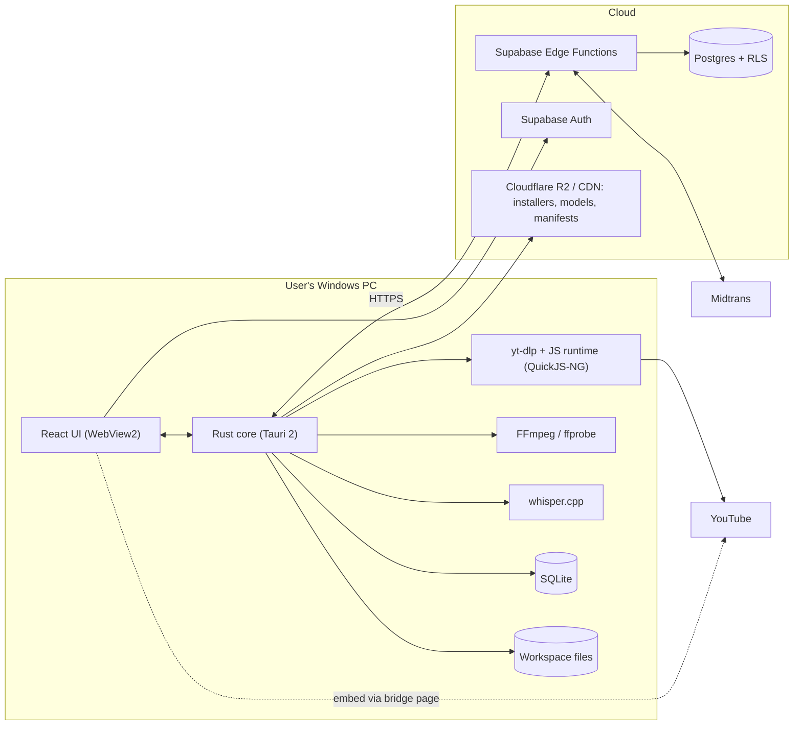
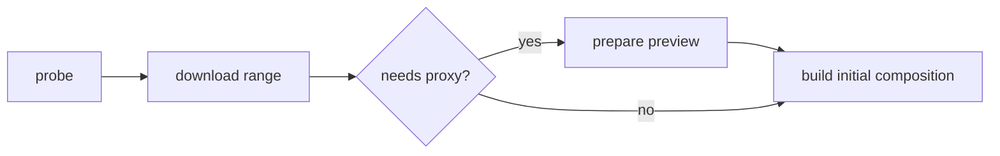
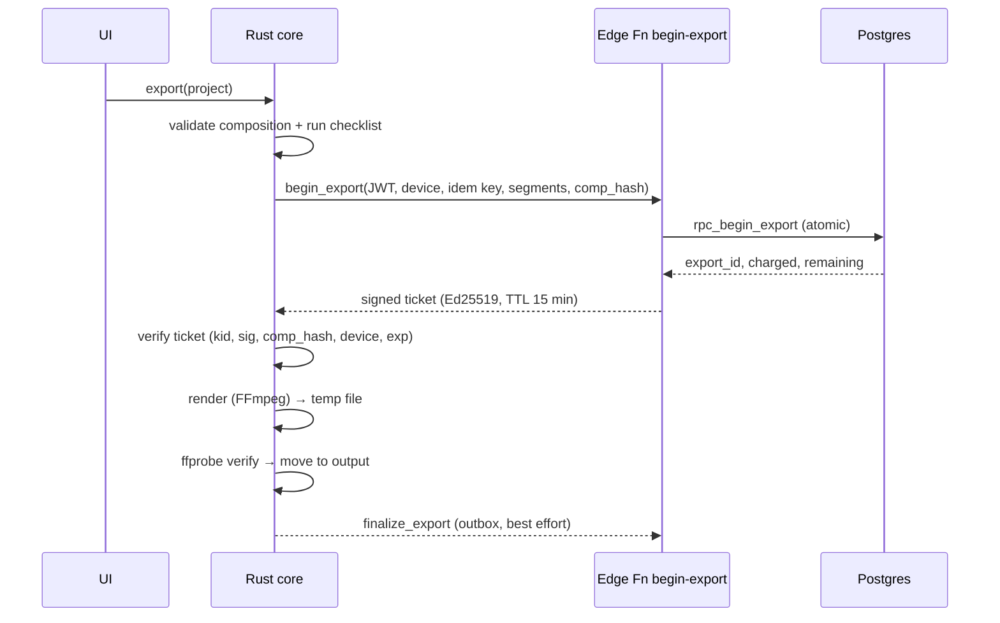

# Architecture

## 1. System context



## 2. Principles

1. **Local-first compute.** Download, transcribe, preview and render run on the user's machine. The cloud holds only identity, money, credits, templates and config.
2. **Server authoritative, client verifying.** The server decides what a user may export; the app verifies a signed ticket before rendering.
3. **Idempotent and resumable.** Every job stage is cacheable by content key and survives crashes.
4. **Schema-validated boundaries.** Composition, templates, tickets, manifests, IPC and HTTP bodies all have versioned schemas.
5. **Config over code.** Plans, limits, tolerances, feature flags, minimum version live in the DB.
6. **Observable by default.** Structured logs, stage timings, error codes, ETA accuracy.
7. **Replaceable edges.** Source providers, encoders, speech model, payment gateway sit behind interfaces.

## 3. Technology choices

| Concern | Choice | Why / alternative |
|---------|--------|-------------------|
| Desktop shell | **Tauri 2** (Rust + WebView2) | Small installer, memory-light, security model (capabilities), sidecar support. Alternative: Electron (all-TS, heavier). |
| UI | React + TypeScript (strict) + Tailwind | Team's existing stack. |
| State | Zustand + immer (editor), TanStack Query (server) | Simple; command-pattern undo/redo on top of the composition. |
| Typed IPC | Rust-generated TS bindings (e.g. tauri-specta) | One source of truth for commands/events. |
| Local DB | SQLite (rusqlite or sqlx) | Projects, jobs, artifacts index, ETA stats, outbox. |
| Secure storage | Windows Credential Manager (`keyring` crate) | Refresh tokens, device secret. |
| Downloader | **yt-dlp** sidecar + **QuickJS-NG** JS runtime | Approach A (`--download-sections`, copy mode) chosen in S1. `--force-keyframes-at-cuts` is **forbidden** (with an LGPL FFmpeg it silently falls back to the mpeg4 encoder). Official `yt-dlp.exe` release (bundles EJS); pin version `2026.10.26` + SHA-256 (`f5389d…7a7d`). QuickJS-NG (`qjs.exe` v0.18.0, MIT, 1.87 MB) via `--js-runtimes "quickjs:<bin_dir>\qjs.exe"`. Deno is **not** bundled but may ship later as a fallback JS runtime via the signed component manifest. Node is supported. Bun is deprecated by yt-dlp — do not use. |
| Media | **FFmpeg + ffprobe** sidecars (LGPL build) | Cut, reframe, burn-in ASS captions, encode, probe. |
| Speech-to-text | **whisper.cpp** sidecar (CPU AVX2 build, v1.9.5 tag `b5454`, commit `d1be6fd`; optional Vulkan build) | Local, MIT, good Indonesian support; flags `-l id -dtw <canonical base> -nfa -sow -sns -ojf`. The Rust core maps quantized model names to canonical presets (`small-q5_1` → `small`; unknown → disable DTW and set `timingSource` accordingly). IMPORTANT: flash attention disables DTW (0 DTW words with `-fa`), so always pass `-nfa` with DTW. Runtime self-check: after each run require ≥95% tokens with `t_dtw >= 0`, otherwise mark `timingSource != 'dtw'` and log it (non-fatal). Capability test against the pinned binary re-run on every whisper.cpp update. Converter spec: word $t_0/t_1$ from `t_dtw * 10` ms, never from `offsets.from`; each word carries `timingSource: 'dtw'|'interpolated'|'segment'`. Karaoke highlighting requires `'dtw'`; otherwise phrase-level reveal. Character-proportional interpolation is measured to drift mean 0.7–1.1 s (max 7 s): never use it for word-level highlighting. Threads = `min(6, physical cores)`, VAD OFF by default (measured word loss on gaming audio), phrase blocklist in `app_config` for known hallucinated outros, 2 s context padding per side (words filtered by center). Models/binaries distributed via signed component manifest + Cloudflare R2 mirror. Word timing is SUPPORTED by an automated unanchored check (n=338 words, 3 samples, median abs error 29 ms, mean bias +7 ms [95% CI +1.4, +13.0]); PENDING (a) human timing audit (30 words/sample) and (b) negative control (shifted timestamps ±100/±200/±300 ms vs onset density). `caption_lead_offset_ms = 0` default. |
| Captions | ASS subtitles burned by FFmpeg (libass); preview with the same renderer (e.g. libass-WASM/JASSUB) | Preview == export. |
| Backend | **Supabase** (Postgres, Auth, Edge Functions, Storage) in **Singapore** | Closest region to Indonesia; one platform; RLS. |
| Payments | **Midtrans Snap** (hosted checkout) | Already registered; QRIS/e-wallet/VA/cards without handling card data. |
| Static hosting | Cloudflare R2 + CDN (installers, models, manifests) | No egress fees for multi-GB distribution. |
| Web (small) | Astro static site on Vercel/Cloudflare Pages | Landing, legal pages, payment-finish page. |
| Crash/error reporting | Sentry (opt-in in app; always on for Edge Functions) | Visibility without building tooling. |
| CI/CD | GitHub Actions (Windows runner) | Build, test, sign, publish, generate update manifests. |

## 4. Desktop app structure

```
apps/desktop/
├─ src/                    # React UI
│  ├─ features/{home,source,generate,editor,templates,export,account,settings}
│  ├─ components/ ├─ state/ ├─ ipc/ (generated) └─ i18n/
└─ src-tauri/src/
   ├─ commands/            # thin Tauri commands (validate → call services)
   ├─ jobs/                # job runner, stage pipeline, cancellation, resume
   ├─ sidecars/            # yt_dlp, ffmpeg, whisper, deno wrappers + Job Object supervisor
   ├─ render/              # composition → FFmpeg args + ASS generation + verification
   ├─ eta/                 # progress aggregation + ETA estimator
   ├─ license/             # ticket verification (Ed25519), account snapshot, device identity
   ├─ net/                 # API client (Edge Functions), retry, backoff, outbox
   ├─ store/               # SQLite, migrations, artifact index, cache policy
   ├─ hardware/            # probe + benchmark + device profile
   ├─ updater/             # app updater + component manifest installer
   └─ security/            # path sanitizing, URL allowlist, integrity checks
```

**IPC contract:** UI → Rust via typed `invoke` commands; Rust → UI via events (`job://<id>` carrying `JobEvent`, see PROGRESS_AND_ETA §3). The UI never spawns processes or touches arbitrary paths.

**Tauri capabilities (least privilege):** no broad shell/fs permissions; sidecars only through Rust; asset protocol scoped to the workspace directory; production builds with devtools disabled and a strict CSP (no remote scripts; `frame-src` limited to the bridge origin).

## 5. Pipelines

### 5.1 Generate (free)



| Stage | Tool | Work unit | Cache key |
|-------|------|-----------|-----------|
| probe | yt-dlp `-J` | – (indeterminate, ≤30 s timeout) | – |
| download | yt-dlp `--download-sections` (copy mode with editing handles `[start − H, end + H]` clipped to `[0, duration]`, `H = range_handle_seconds` default 5 s); reuses probe JSON via `--load-info-json` (saves ~6 s extraction). Probe JSON is a **temp file** (contains signed URLs, ~6 h TTL) — delete after the stage, never log or sync. On 403 from URL expiry: silent re-probe once and retry; only then surface `E_YT_RATE_LIMITED`. | media-seconds (from FFmpeg `time=`/`speed=` output, ~1.4–1.9 ev/s; 6–11 s startup is indeterminate — show "Menyiapkan unduhan…") | sha256(provider, video_id, start_ms, end_ms, format selector, handles) |
| prepare preview | FFmpeg (only when source codec is not WebView2-native H.264/AAC — e.g. VP9/AV1/Opus); proxy transcode via `h264_mf` at `-b:v 3500k` with a short GOP (`-g 30`, `-pix_fmt yuv420p`, AAC 128k, `-movflags +faststart`, without `-profile:v`). Final export always uses the original file. | media-seconds | sha256(proxy_v1, source artifact, preset) |
| build | Rust (`CompositionV1` JSON + canonical SHA-256 hash written to `projects/<id>/composition.json` & SQLite) | – (<2 s) | – |

Rules:
- **One generate at a time.** Heavy stages run with hardware-appropriate concurrency (default 1), enforced by persistent SQLite `jobs` + `JobCoordinator`; leftover `running`/`queued` rows after an unclean exit reconcile to `interrupted` at startup, purge `cache/tmp/<job_id>`, and offer "Ulangi". Stage weights adjust dynamically between 3-stage (`5% / 92% / 3%`) when native H.264/AAC skips proxy generation and 4-stage (`5% / 85% / 8% / 2%`) when `prepare_preview` runs.
- Download format preference: H.264 ≤1080p + AAC (plays natively in WebView2, no proxy). Fall back to other codecs + proxy.
- Copy-mode output may contain pre-roll packets before the requested start (negative PTS, discard flag `KD_`). Working definition: `absoluteStartMs = requestedStartMs`; file t=0 = requested start (pre-roll packets are discarded). S1c verified RELATIVE consistency between two downloads ($T$ vs $T-7\text{ s}$) by audio cross-correlation at 3 offsets (0.00 ms error). NOT verified: absolute alignment to YouTube's own player timeline (irrelevant beyond the 15 s entitlement tolerance) and WebView2 `<video>` seeking behavior (inferred, not measured). The M1 sync test (known marker + captions, preview and export align within ±1 frame) remains a hard acceptance gate. Keep a configurable **±5 s** of "editing handles" around the chosen range for trim fine-tuning.
- Baseline copy-mode download measured at **≈1.66× real-time** (5 min range ≈ 3 min, ~94 MB at 1080p60 on Reference R1). YouTube paces un-chunked DASH requests by **TIME** (720p took the same wall time as 1080p), while yt-dlp's native chunked downloader reaches **≈8× real-time** on the same link. Parallel split ($N=2/3/4$) was rejected (not $\ge 2\times$ faster, and copy-mode joins broke at $N=4$). Sequential copy-mode is retained as baseline and placed behind a `RangeDownloader` trait in the Rust core design. Open item S1d (optional, after M1 baseline works): a local range-chunking proxy so FFmpeg reads through chunked upstream requests.
- Failures are stage-scoped; retry resumes from the last good artifact.

### 5.2 Captions (free local operation)

Captions are a separate free local operation started after the user trims: triggered via the "Buat caption" button or auto-offered upon opening the Captions tab. We **never transcribe the whole downloaded range or full VOD** — only the trimmed segment(s).

```mermaid
flowchart LR
  A[extract audio (trimmed segment ± 2s)] --> B[transcribe (whisper.cpp)] --> C[map to timeline]
```

| Stage | Tool | Work unit | Cache key |
|-------|------|-----------|-----------|
| extract audio | FFmpeg → 16 kHz mono WAV for trimmed segment(s) (+ ~2 s context padding each side) | audio-seconds | sha256(segment audio extract) |
| transcribe | whisper.cpp (`--print-progress`) | audio-seconds | sha256(segment audio hash, model, language, vad, dtw) |
| map | Rust (map source-relative words to output timeline, re-apply user edits) | – (<1 s) | – |

Rules:
- Audio extracted ONLY for the trimmed segment(s) (+ ~2 s context padding each side for acoustic and boundary phonetic continuity).
- Multiple segments on the timeline are transcribed independently (each padded), then mapped to output timeline positions.
- Transcript cache key = `sha256(segment audio hash, model, language, vad, dtw)`.
- ETA includes model load / warm-up overhead (~0.5–1.0 s) + `clip_seconds × RTF prior`. Trim bounds are snapshotted when the job starts.
- Cancelling `captions` never blocks editing: partial results are discarded, and `captions.status` returns to `'none'`.
- Shrinking the trim keeps existing captions valid (words outside the new trim bounds are hidden). Extending beyond transcribed coverage marks `captions.status = 'stale'` and prompts re-run (MVP: re-transcribe the new clip; delta transcription is post-MVP). User text/timing edits survive re-trims.

### 5.3 Export (credit-gated)



Details in SECURITY §5 and DATA_MODEL §5. The credit is consumed (or the entitlement matched) **at ticket issue**; failures afterwards are retried free.

## 6. YouTube source handling

- **URL intake:** parse in Rust; allow only `youtube.com`, `www.youtube.com`, `m.youtube.com`, `youtu.be`; extract an 11-char video id; build the canonical `https://www.youtube.com/watch?v=<id>` URL. Never pass user text to a shell.
- **yt-dlp flags:** `--no-playlist --no-warnings --newline --ignore-config`, `--js-runtimes "quickjs:<bin_dir>\qjs.exe"`, `--ffmpeg-location <bin_dir>`, `--load-info-json <probe_json>` (reuses the `-J` output), format selector `bv*[vcodec^=avc1][height<=1080]+ba[acodec^=mp4a]/b[vcodec^=avc1][height<=1080]/bv*[height<=1080]+ba/b[height<=1080]`, `--download-sections "*<start>-<end>"`. **Never** pass `--force-keyframes-at-cuts` (see §3).
- **Probe/download split (`ProbeHandle` lifecycle):** probe with `yt-dlp -J --no-playlist --no-warnings --ignore-config --js-runtimes quickjs:<abs> --cache-dir <ws> -f <S1 selector> -- <canonical_url>` (30 s timeout, 20 MB stdout cap, cancellation, 2 s heartbeat progress events). Persist the raw `-J` JSON strictly as `cache/probe/<uuid>.json` behind an opaque backend `ProbeHandle` (never exposed to UI, logs, diagnostics, or sync). Title and channel strings are stripped of control/bidi characters, whitespace-collapsed, and capped at 200 chars before IPC/SQLite persistence. Downstream M1.4 download passes the handle's temp file via `--load-info-json` (~6 s extraction savings) and calls `ensure_fresh_probe(handle)` to re-probe once when signed `expire=` query/path timestamps are expired (or within 60 s margin) or on HTTP 403 retry; delete the temp file immediately after download, and prune any `cache/probe/` files older than 1 h at startup (`cleanup_stale_probe_files`). Only surface `E_YT_RATE_LIMITED` if retry also fails.
- **Progress observability (S1 decision — Approach A):** yt-dlp's internal FFmpeg emits `time=`/`speed=` lines at ~1.4–1.9 events/s in copy mode. The 6–11 s startup (extraction + JS challenge resolution) is indeterminate. Reference implementation: `spikes/s1-downloader/progress_parser.py` (port to Rust with the same unit-test cases).
- **Preview proxy for non-AVC1 sources:** when the downloaded stream is not H.264/AAC (e.g. VP9/AV1-only streams), generate a preview proxy with FFmpeg using `h264_mf` at `-b:v 3500k -g 30 -pix_fmt yuv420p` (`-g 30` added as TO-VERIFY: confirm smooth, frame-accurate seeking in WebView2 during M1). The editor and UI preview play this proxy; final export always renders from the original source file. Note: `h264_mf` routes to the GPU vendor's hardware MFT and falls back to a slower software MFT when no hardware encoder exists; to be re-tested on other GPUs during beta. In the Generate stage table (§5.1), `prepare_preview` applies only to this case.
- **Preview strategy (D-13 verified in S2, Protocol v1):**
  1. **Official YouTube embed through the hosted bridge:** hosted at `https://clipper-bridge.vercel.app` (production Vercel deployment with root `apps/bridge`; migrate to owned domain `player.<domain>` before launch in M5). The bridge loads the official loader `https://www.youtube.com/iframe_api` (note: `youtube-nocookie.com/iframe_api` returns HTTP 404), supplies a genuine HTTPS origin and `Referrer-Policy: strict-origin-when-cross-origin` to eliminate Error 153, and communicates strictly via Protocol v1 `hello{v,nonce}` / `ready{v,nonce}` handshake (`BridgeSession`) without wildcard `'*'` `postMessage` targets, `<= 2 KB` messages, rate limiting, and `>= 200×200` player dimensions with zero overlays inside the player box. Direct embed inside WebView2 and a loopback local bridge are **NOT pursued for MVP**.
  2. **Fallback: Timecode-Only Mode (MVP):** If the yt-dlp probe indicates `playable_in_embed=false`, or the bridge reports error 101/150 (confirmed against `preview.control_video_id` in `app_config`), or protocol mismatch occurs, or no `ready` arrives within 6 s, the UI cleanly switches to "timecode-only mode": displays message *"Pratinjau tidak tersedia untuk video ini"*, start/end timecode inputs with ±1/±5 s nudges, a **"Buka video di browser"** button (restricted strictly to `https://www.youtube.com/watch?v=<id>[&t=…]`), and live estimated download time (`range / 1.66 + 10 s`). Storyboard scrubber is **cut from MVP** and moved to the post-MVP backlog. Preview mode, `bridge_ready_ms`, `fallback_reason`, `yt_error_code`, and allowlisted local counters (`embed_disabled_count`, `fallback_count`, `config_error_count`) are recorded in `settings` + the diagnostics `### Preview` section.
  3. **Mode switch vs Error code:** A mode switch to timecode-only is a normal UI state, **not an error code**. `E_PREVIEW_CONFIG` is added strictly for YouTube error 153 / bridge misconfiguration (auto-switches to timecode-only + records telemetry). Members-only and age-restricted videos are rejected during initial probe and never reach the preview stage.
  4. **Preview timing rules (M1 acceptance tests):**
     - Do not claim fixed 16 Hz updates (empirical measurements show `timeUpdate` arrives at 4–17 Hz depending on stream and browser load); the host UI smoothly extrapolates display time (`time + elapsed × playbackRate`).
     - Seek latency is measured from `seekTo` issuance until player state transitions to `PLAYING` after `BUFFERING`.
     - Ads detection: if player reported duration differs from probe duration by > ±2 s, disable the "set start/end here" buttons and display an in-app notice alerting the user that an ad is playing.
- **Unsupported (MVP):** ongoing live streams, private/members-only/age-restricted content, cookies import.

## 7. Composition and render

- **Composition JSON** (DATA_MODEL §7) is canonical: sources, timeline segments (source-relative ms + absolute offset), layout, captions (word timings), overlays, audio, template reference. Coordinates are **normalized 0–1** so they are resolution-independent. Time mapping working definition: `absoluteStartMs = requestedStartMs`; file t=0 = requested start (pre-roll packets carry discard flag). S1c verified relative consistency across offsets via audio cross-correlation (0.00 ms error); absolute timeline alignment beyond 15 s tolerance and WebView2 playback behavior remain to be validated in M1 sync test. Timeline segments map back to absolute VOD time via `absoluteStartMs` for entitlement matching.
- **Canonicalization + hash:** keys sorted, numbers normalized → `comp_hash` (SHA-256). Included in the export ticket. `comp_hash` covers the derived words (`captions.words`) and user overrides (`captions.edits`).
- **Render builder (Rust):** composition → FFmpeg filtergraph + ASS file.
  - `fill`: crop rect → scale to 1080×1920.
  - `blur_fit`: blurred scaled background (using LGPL filter `gblur=sigma=30:steps=2` or `avgblur`; `boxblur` is GPL-only and strictly absent in LGPL builds) + centered contained foreground.
  - `split`: two crops stacked by ratio.
  - Captions: generate ASS (animations: `'none'`, `'phrase'` line-level reveal, `'word_highlight'` karaoke tags, or `'pop'`). Per-word animations (`'word_highlight'` and `'pop'`) both require words with `timingSource == 'dtw'`; when words lack `timingSource 'dtw'`, both render as `'phrase'`. Burn with `ass`/`subtitles` filter, fonts from the bundled OFL set only (Montserrat, Poppins, Inter, Anton). Emojis are **stripped in MVP** because bundled typography fonts lack color emoji tables (COLR/CPAL/SVG) and fontconfig-free sidecars render empty glyphs or missing boxes (`[]`).
  - Windows filter-path escaping contract:
    ```python
    def escape_filter_path(p: str) -> str:
        return p.replace("\\", "/").replace(":", r"\:")
    ```
    Paths passed as `ass=filename='F\:/path/to/caption.ass':fontsdir='F\:/path/to/fonts'`.
  - Overlays: logo via `overlay`, text via ASS or `drawtext` with bundled fonts.
  - **Two-pass audio loudness normalization pipeline:**
    - Assumed by PROGRESS_AND_ETA stage `analyze_audio` (audio-only analysis pass) + render stage:
      - Pass 1 (`analyze_audio`): `ffmpeg -i <audio> -af "loudnorm=I=-14.0:TP=-1.5:LRA=11:print_format=json" -f null -` (parses `measured_I`, `measured_TP`, `measured_LRA`, `measured_thresh`, and `target_offset`).
      - Pass 2 (`render`): main filtergraph injects measured parameters in linear mode: `volume=<gain>dB,loudnorm=I=-14.0:TP=-1.5:LRA=11:measured_I=...:measured_TP=...:measured_LRA=...:measured_thresh=...:offset=...:linear=true,aresample=48000`.
    - Default target: **−14.0 LUFS** (template-configurable via `audio.targetLufs`, e.g. −16.0 LUFS for broadcast). Softened platform note: YouTube normalizes around −14 LUFS; other platforms are not verified.
    - Note on dynamic headroom: with the −1.5 dBTP ceiling, linear mode landed ~1.5 LU below target on peaky gaming audio (−15.5 LUFS for −14.0 LUFS target) because linear gain backs off to prevent transient clipping. Added evaluation item: test a true-peak limiter before loudnorm in post-M1 optimization.
  - Output: H.264 High, yuv420p, 30 fps default (template may set 60), AAC 48 kHz stereo 128–192 kbps, `+faststart`. Output containers always specify `-color_primaries bt709 -color_trc bt709 -colorspace bt709 -color_range tv -movflags +faststart`.
  - **Export presets & rate control (S4 verified on R1):**
    - **`standard` (quality target):**
      - `h264_amf` (AMD GPU, measured on R1): `-usage transcoding -rc vbr_peak -b:v 4500k -maxrate 6000k -bufsize 9000k -quality quality -profile:v high -level 4.2 -g 30`. (`vbr_peak` selected over `vbr_latency` for offline export because it avoids latency throttling, achieving 4.4 Mbps target accuracy vs 4.0 Mbps underrun, +1.58 dB PSNR, and 97.69 VMAF).
      - `h264_mf` (Media Foundation, measured on R1): `-b:v 4500k -rate_control pc_vbr -g 30`. **CRITICAL:** never pass `-profile:v` to `h264_mf` (MFT manages profile internally; passing `-profile:v high` triggers syntax error `Invalid argument`).
      - `h264_nvenc` (NVIDIA GPU, **UNTESTED / PLACEHOLDER**): `-rc vbr -cq 23 -b:v 4500k -maxrate 6000k -bufsize 9000k -profile:v high -g 30`.
      - `h264_qsv` (Intel QSV, **UNTESTED / PLACEHOLDER**): `-global_quality 23 -b:v 4500k -maxrate 6000k -profile:v high -g 30`.
    - **`small_file` (bitrate-capped for templates with maxFileSizeMB):**
      - `h264_amf` (Measured on R1): `-usage transcoding -rc cbr -b:v 2500k -maxrate 2500k -bufsize 5000k -profile:v high -level 4.2 -g 30`.
      - `h264_mf` (Measured on R1): `-b:v 2500k -rate_control cbr -g 30`.
      - `h264_nvenc` (**UNTESTED / PLACEHOLDER**): `-rc cbr -b:v 2500k -maxrate 2500k -bufsize 5000k -profile:v high -g 30`.
      - `h264_qsv` (**UNTESTED / PLACEHOLDER**): `-b:v 2500k -maxrate 2500k -bufsize 5000k -profile:v high -g 30`.
    - Users cannot set CRF/bitrate directly in MVP; fps and resolution come from the template.
  - **HW vs SW decode:** Default to **software decode** for maximum export speed on mid-spec CPUs (Class B/A, 6+ logical cores). D3D11VA hardware decode cuts CPU load by >50% (from 27% to 12%), but adds ~7–10 s wall time due to GPU-to-CPU surface copies for CPU-based `libass` subtitle burn-in. D3D11VA is retained as an optional low-CPU / battery-saver setting.
  - **Disk space guard:** Before rendering, Rust checks `required_bytes = 1.5 × estimated_output_bytes + 500 MB headroom`. If free disk space is insufficient, raises `E_DISK_LOW` without invoking FFmpeg.
  - **Temp file handling & cleanup:** Output writes to `%LOCALAPPDATA%\...\cache\<job_id>.mp4.tmp` with `-f mp4`. On cancel, crash, or error, the supervisor process terminates FFmpeg via Windows Job Object (`kill-on-close`) and immediately deletes partial `.tmp` artifacts.
- **Preview parity:** UI preview applies the same crop/scale math from the shared module and renders ASS with the same libass-based renderer. **Golden tests** compare composition → FFmpeg-args snapshots and ffprobe metadata of a short fixture render.
- **Editor v1 CSS transform parity:** `cropRectToCssTransform` in `apps/desktop/src/editor/cropMath.ts` maps a normalized `Rect` (`{x, y, w, h}` in 0..1 of the source frame) to CSS `width%/height%/translate%` that positions the same pixel sub-region as `crop=iw*w:ih*h:iw*x:ih*y,scale=1080:1920` in FFmpeg. The pure functions in `cropMath.ts` are shared between the preview and the future render builder (Rust) to maintain exact parity.
- **HTTP Range seeking:** Tauri 2.12.7 asset protocol supports `206 Partial Content` natively (verified in `protocol/asset.rs`), enabling frame-accurate scrubbing in the editor without custom range handling.
- **Post-render verification checklist (`verify_export.py`):**
  1. Container faststart: binary inspection verifies `moov` atom precedes `mdat` atom.
  2. Video stream: codec `h264`, dimensions exactly `1080×1920`, framerate `30 fps` (or 60 fps per template), pixel format `yuv420p`, color tags `bt709 tv`.
  3. Audio stream: codec `aac`, sample rate `48000 Hz` (or 44100 Hz), stereo.
  4. Duration: rendered duration within ±0.5 s of requested composition timeline.
- **Encoder selection & fallback chain:** probe `h264_nvenc` → `h264_qsv` → `h264_amf` → `h264_mf` → `E_ENCODER_UNAVAILABLE`. `libopenh264` and `x264` are **unapproved** pending legal counsel review (see docs/compliance/FFMPEG.md §7 and ARCHITECTURE §15). Fallback chain demonstrated in S4b: unsupported encoders fail fast (<0.25 s each, exit code -22 `Invalid argument`), transitioning cleanly to working hardware in 1.70 s total. Stderr patterns mapped directly to catalog codes.

## 8. Hardware profile and adaptive defaults

First run (and "Re-run benchmark" in settings): probe CPU model/cores/AVX2, RAM, GPUs, free disk; test-encode with each encoder; run a ~10 s whisper micro-benchmark. Produce a `device_profile` (class A/B/C) and measured rate priors for ETA (speech priors apply to CLIP length, not range length). Defaults:

| Setting | Rule |
|---------|------|
| Speech model | **PROVISIONAL:** `small-q5_1` (181 MB) if RAM ≥ 8 GB AND first-run micro-benchmark projected RTF for `small-q5_1` ≤ 1.5; otherwise `base` (141 MB). RAM alone is not enough. User can override (Tiny…Medium; `medium` is an optional user override with a speed warning). *Provisional status: final_*.txt files are identical to the uncorrected medium draft (no human correction yet); every WER/CER is distance from the medium reference, not accuracy; medium's 0% is circular. Word timing SUPPORTED by an automated unanchored check (n=338 words, 3 samples, median abs error 29 ms, mean bias +7 ms [95% CI +1.4, +13.0]); PENDING (a) human timing audit (30 words/sample) and (b) negative control (shifted timestamps ±100/±200/±300 ms vs onset density). Karaoke highlighting requires `timingSource == 'dtw'`; otherwise phrase-level reveal. Character-proportional interpolation is measured to drift mean 0.7–1.1 s (max 7 s): never use it for word-level highlighting. `caption_lead_offset_ms = 0` default.* |
| Whisper sidecar & backend | whisper.cpp CPU AVX2 build (v1.9.5, release tag `b5454`, commit `d1be6fd`). Flags: `-l id -dtw <canonical base> -nfa -sow -sns -ojf`. The Rust core maps quantized model names to canonical presets (`small-q5_1` → `small`; unknown → disable DTW and set `timingSource` accordingly). IMPORTANT: flash attention disables DTW (0 DTW words with `-fa`), so always pass `-nfa` with DTW. Runtime self-check: after each run require ≥95% tokens with `t_dtw >= 0`, otherwise mark `timingSource != 'dtw'` and log it (non-fatal). Capability test against the pinned binary re-run on every whisper.cpp update. Threads = `min(6, physical cores)`. VAD OFF by default (measured word loss on gaming audio). Phrase blocklist in `app_config` for known hallucinated outros. 2 s context padding per side (words filtered by center). Model/binary manifest + Cloudflare R2 mirror. Synthetic heartbeat every 2 s. Vulkan build optional post-M1 if probe shows clear benefit. |
| Speech ETA prior | Model-init prior: **8 s**. Transcribe rate prior: **RANGE 1.1–2.2× real-time** depending on speech density; marked low confidence until measured on device. ETA formula: `clip_seconds / rate + 8 s`. |
| Concurrency | 1 heavy stage at a time (A/B), 2 on high-end. |
| Encoder | First working in priority order (`h264_nvenc` → `h264_qsv` → `h264_amf` → `h264_mf`). Software decode default; D3D11VA optional. |

## 9. Local storage

```
%LOCALAPPDATA%\ClipperHelper\
├─ bin\        # versioned sidecars (bin/<component>/<version>/<exe>) + manifest cache
├─ models\     # speech models (models/<file>, sha256-verified)
├─ cache\      # content-addressed artifacts (downloads, audio, transcripts, proxies, waveforms)
├─ projects\   # per-project folder: composition.json, thumbnails
├─ outbox\     # (in SQLite) pending finalize/telemetry
├─ logs\       # rotating, redacted
├─ bootstrap.json # optional root override pointing to custom DataRoot
└─ app.db      # SQLite
Default output: %USERPROFILE%\Videos\ClipperHelper\
```

**DataRoot abstraction:** default `%LOCALAPPDATA%\ClipperHelper\` (in debug builds: `%LOCALAPPDATA%\ClipperHelper-Dev\`). A small `bootstrap.json` in the default directory may redirect storage to another root (`{"workspace_root": "D:\\ClipperHelper"}`). Validation rules enforced at startup:
- Must be an absolute path on a **LOCAL FIXED drive** (no UNC/network shares, no removable USB drives).
- Must **not** be a system directory (Windows, System32, Program Files).
- Must be writable and either empty or an existing ClipperHelper workspace directory.
- Logs a warning if the path resides inside OneDrive.
All resolvers strictly operate against the active DataRoot. Dev reset operations (`dev_reset_workspace`) refuse to execute unless the root's final component is exactly `ClipperHelper-Dev`.

**Field reality — low disk space:** Development and user laptops frequently have low free disk space on drive C: (dev machines measured with 2.2–2.7 GB free). Because component downloads, whisper models (141–466 MB), and video artifacts require sufficient disk headroom, the DataRoot abstraction allows users to move their workspace to a secondary drive (e.g. D: or E:). The first-run wizard UI arrives in M1.1d. Before any download or render, `check_free_space(required_bytes)` runs preflight verification, mapping insufficient space to typed errors (`E_DISK_LOW` / `E_DISK_FULL`).

**Component resolution:** binaries are stored in versioned paths `bin/<component>/<version>/<exe>` (e.g. `bin/yt-dlp/2026.10.26/yt-dlp.exe`). Models reside in `models/<file>` strictly against the models allowlist (`ggml-*.bin`). Only allowed components (`yt-dlp.exe`, `qjs.exe`, `ffmpeg.exe`, `ffprobe.exe`, `whisper-cli.exe`, and `fake-sidecar.exe` in debug/test) may be resolved.

**Workspace path safety:** All stored paths (composition, artifacts, cache keys) are POSIX-style and relative to this root, matching `^(cache|projects)/[A-Za-z0-9._/-]+$` — no `..`, no leading `/`, no drive letters, no UNC paths. Only one Rust function `resolve_workspace_path()` may convert a stored path into an absolute OS path; it canonicalizes the result and verifies it stays inside the workspace root (including across symlinks and NTFS junctions).

- **Cache policy:** LRU of unpinned artifacts; default cap 10 GB; sources older than 7 days eligible. Deleting a cached source only means a free re-download.
- **Disk guard:** before download require free space ≥ 2 × estimated size + 1 GB; before render ≥ 1.5 × estimated output + 500 MB.
- **Atomic writes:** write to `*.tmp` → verify (hash/ffprobe) → rename.
- **Crash recovery:** `jobs` table records stage + artifacts; on start, reconcile orphan processes (Job Object ensures none survive) and offer resume.

## 10. Server architecture

| Component | Responsibility |
|-----------|----------------|
| Supabase Auth | Google OAuth (PKCE), email OTP, sessions, MFA for admins. |
| Postgres | Source of truth (DATA_MODEL). All sensitive writes in `SECURITY DEFINER` functions. |
| Edge Functions | `register-device`, `begin-export`, `finalize-export`, `create-checkout`, `midtrans-webhook`, `reconcile-orders` (scheduled), `get-app-config`, `get-component-manifest`, `ingest-events`, `share-template`, `import-template`. |
| Client RPCs (RLS-safe, `auth.uid()`) | `get_account_status`, `list_devices`, `revoke_device`, `list_orders`. |
| Storage | Template assets (logos ≤ 2 MB). Large binaries are **not** here. |
| Scheduled jobs | `reconcile-orders` (hourly), partition/retention for `events`, expiry of stale devices. |

- **API versioning:** `/v1` path; clients send `X-App-Version` and `X-Api-Version`. Server returns `E_APP_OUTDATED` below `min_app_version`.
- **Rate limiting:** coarse limits at the edge (Cloudflare in front of the custom domain) plus per-user/per-device limits in a Postgres `check_rate_limit(key, limit, window)` function; stricter on `begin-export`, `register-device`, OTP.
- **Config delivery:** `get-app-config` is cacheable (ETag); app refreshes on start and every few hours.
- **Region:** Supabase Singapore (`ap-southeast-1`).

## 11. Admin dashboard boundary

The dashboard (later) uses the same Supabase project, separate Auth audience/role (`admin_users`, MFA), and **only** audited admin RPCs for writes. The schema in DATA_MODEL already supports manual grants and audit logs so no migration is needed when the dashboard arrives. See ADMIN_DASHBOARD.md.

## 12. Scalability

**Why the architecture scales:** the expensive work (video) is distributed across users' machines; the server handles a few tiny transactional requests per active user per day.

Back-of-envelope (assumptions, not promises): 10k MAU, 30% DAU, 4 exports/day → ~12k `begin-export`/day ≈ 0.14 rps average, a few rps at peak; 100× growth is still tens of rps. `rpc_begin_export` is a handful of indexed queries in one transaction under a per-user row lock → comfortably within a single small Postgres instance.

| Area | Hot path | Scaling lever |
|------|----------|---------------|
| `begin-export` | 1 RPC, per-user lock | Indexes on `(user_id, local_day)`, `(user_id, source_video_id)`; Supavisor pooling; vertical scale; read replica for dashboards. |
| Webhooks | Rare, bursty | Idempotent; fast 2xx after durable write; reconciliation covers misses. |
| Telemetry | Batched | Client batches (≤100 events / 5 min); monthly partitions; 90-day retention; can move to a dedicated analytics sink later. |
| Binaries/models | **Largest bandwidth** (models are hundreds of MB; installers ~100+ MB) | Cloudflare R2/CDN, versioned immutable URLs, resumable downloads, SHA-256 verification. |
| Config | Read-heavy | ETag + client cache. |
| Ledger growth | Append-only | Partition by month when > tens of millions of rows; summary table for dashboards. |

Cost drivers: Supabase plan, CDN requests, Sentry volume, payment fees. No per-minute compute cost.

## 13. Release and update management

- **App:** Tauri updater with signed artifacts; channels `stable`/`beta`; staged rollout percentage in the update manifest; the previous version stays available for rollback.
- **Signed component manifest (`manifest.json`):**
  - **Schema:** `{ schema: 1, sequence: monotonic_int, generated_at: ISO8601, channel: "stable"|"beta"|"dev", components: [...] }`. Each component entry declares `component`, `version`, `platform`, `url`, optional `mirrors`, `size_bytes`, `sha256`, `archive` (`"none"`|`"zip"`), relative `files` (with hashes/sizes for zip bundles), `min_app_version`, optional `max_app_version`, and `rollout_percent`.
  - **Detached signature (`manifest.json.sig`):** Ed25519 signature evaluated over the **exact served bytes** of `manifest.json`. Checked using `ed25519_dalek::VerifyingKey::verify_strict`. Pinned embedded public keys carry an explicit `kid` (active + next, kept strictly separate from export ticket signing keys).
  - **Anti-rollback floor:** Monotonic sequence number is persisted in local SQLite storage. Even if the local database is reset or reconstructed after corruption recovery, an embedded build-time constant `MIN_MANIFEST_SEQUENCE` serves as a permanent floor (`effective_floor = max(persisted, MIN_MANIFEST_SEQUENCE)`). Manifest sequences strictly below this floor are rejected with `E_MANIFEST_STALE`.
  - **Component gating:** Incompatible app versions (`min_app_version` / `max_app_version`) or rollout buckets outside `rollout_percent` are cleanly skipped without erroring.
- **Resumable downloader:** downloads are performed with reqwest + rustls over HTTPS (loopback `http://127.0.0.1` permitted only in debug/test builds), host-allowlist validated with redirect security, streaming SHA-256 verification, strict size bounds, `.part` file resume with `Range` / `If-Range` headers, per-component download mutex, and progress events with EWMA smoothed rate and ETA per PROGRESS_AND_ETA §4–§5.
- **Emergency path:** `min_app_version`, `maintenance` flag, component rollback, kill switch for a bad component version (set `is_active=false`).
- **Windows distribution:** per-user NSIS/MSI installer, Authenticode code signing, direct download from our site. Expect antivirus false positives for bundled downloaders; budget time for allow-listing/reputation.

## 14. Observability

- **Local logs:** structured (`tracing`), rotating (7 days / 20 MB), redacted (no tokens, no full URLs, no transcript text). "Export diagnostics" zips logs + device profile + versions.
- **Crash reporting:** Sentry in the app, **opt-in**; Edge Functions always instrumented.
- **Telemetry (opt-in):** event names and fields enumerated in SECURITY §11. Includes stage durations by device class to improve ETA priors.
- **Server dashboards/alerts:** error rate per function, `begin-export` latency, webhook failures, reconciliation mismatches, abuse flags, component failure rate by version.

## 15. Third-party components and licensing

| Component | License | Obligation / note |
|-----------|---------|-------------------|
| Tauri, React, Tailwind, Zustand, TanStack Query | MIT/Apache-2.0 | Notices in About screen. |
| yt-dlp | Unlicense | Platform ToS risk is separate from copyright license (see PRD risks). |
| Deno | MIT | Not bundled in MVP; may ship later as a fallback JS runtime via the signed component manifest. |
| QuickJS-NG | MIT | Bundled JS runtime for yt-dlp (`qjs.exe`, 1.87 MB). Pin version + SHA-256 in component manifest. |
| whisper.cpp + OpenAI Whisper weights | MIT | Verify model file checksums; keep notices. |
| FFmpeg | **LGPLv3** (Decision D-11) | Ship BtbN release-branch shared LGPL build (`n9.0.2-58-g8c7ef49002`, commit `8c7ef49002`, archive SHA-256 `1fdb837def412ad7cc019874b6310156f40179bd30df58d041a82413f800a331`, zip 74.14 MB, extracted 183.05 MB: `ffmpeg.exe`, `ffprobe.exe`, 7 DLLs). Effective license is **LGPLv3** (`--enable-version3`, no `--enable-gpl`, no `--enable-nonfree`). Uses native Windows Schannel TLS. `boxblur` absent (GPL-only), replaced by `gblur`/`avgblur`. Called strictly as a separate process via argument arrays in a Windows Job Object. Source mirrored on Cloudflare R2; user replacement supported per `docs/compliance/FFMPEG.md`. |
| x264 / x265 | GPL | **Not bundled** unless legal review approves (also consider H.264 patent licensing). Hardware encoders (NVENC/QSV/AMF) and Windows Media Foundation encode avoid shipping an encoder. |
| libass | ISC | Used via FFmpeg and preview renderer. |
| Fonts for captions | Use only SIL OFL/Apache fonts (e.g. Montserrat, Poppins, Inter, Anton) | Never bundle commercial fonts; templates can only reference bundled fonts. |
| Music | – | No bundled copyrighted music; no music library in MVP. |

Record every added binary here with version, license, source URL, SHA-256 and build flags. Generate an SBOM in CI.

## 16. Error handling

All failures map to catalog codes (`E_*`) with: user message (id/en), retryable flag, suggested action, auto-recovery behavior (PROGRESS_AND_ETA §8). Logs carry the code + stage + redacted context. Sidecar exit codes and stderr patterns are translated in one place (`sidecars/` adapters), never in the UI.

## 17. Testing strategy (summary; details in ROADMAP §4)

Unit (rules engine, ETA estimator, composition→FFmpeg args, URL parser, ticket verification) · property/fuzz (template import, URL parsing) · integration (job runner with fake sidecars; stage resume) · DB (pgTAP incl. concurrent `begin_export`) · webhook fixtures (valid/forged/duplicate/out-of-order) · E2E smoke on Windows runner with a short fixture clip · load test (`begin-export`) · security checklist (SECURITY §13).

## 18. Web components (small, MVP)

`apps/web` (Astro, static): landing + download, `/terms`, `/privacy`, `/refund`, `/pay/finish` ("payment received — return to the app"; never grants anything), `player` bridge page for the embed (currently deployed as standalone `apps/bridge` at `https://clipper-bridge.vercel.app`; migrate to owned domain in M5). Later: account portal and CAPTCHA-protected login (decided in spike S7).

## 19. macOS / web later

- **macOS:** the Tauri codebase builds for macOS; needs Apple Developer Program (notarization), universal binaries for sidecars, VideoToolbox encoder path, and separate QA. Likely less work than a web port.
- **Web:** browsers cannot run yt-dlp (no cross-origin VOD download), FFmpeg-WASM is slow and memory-limited → a web version would be **upload-file-based** with short clips: a different product. Keep `packages/shared`, the composition model, templates and credit logic UI-agnostic so a web editor can reuse them.

## 20. Known risks and spikes

Resolved in M0 (ROADMAP §2): S1 downloader progress/approach · S2 embed bridge on WebView2 · S3 whisper model/backends/Indonesian quality · S4 encoders + ASS burn-in + export speed · S5 FFmpeg build/legal · S6 Supabase/Midtrans sandbox/CI signing · S7 login CAPTCHA feasibility.
